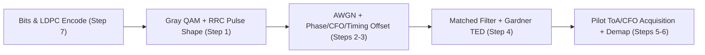
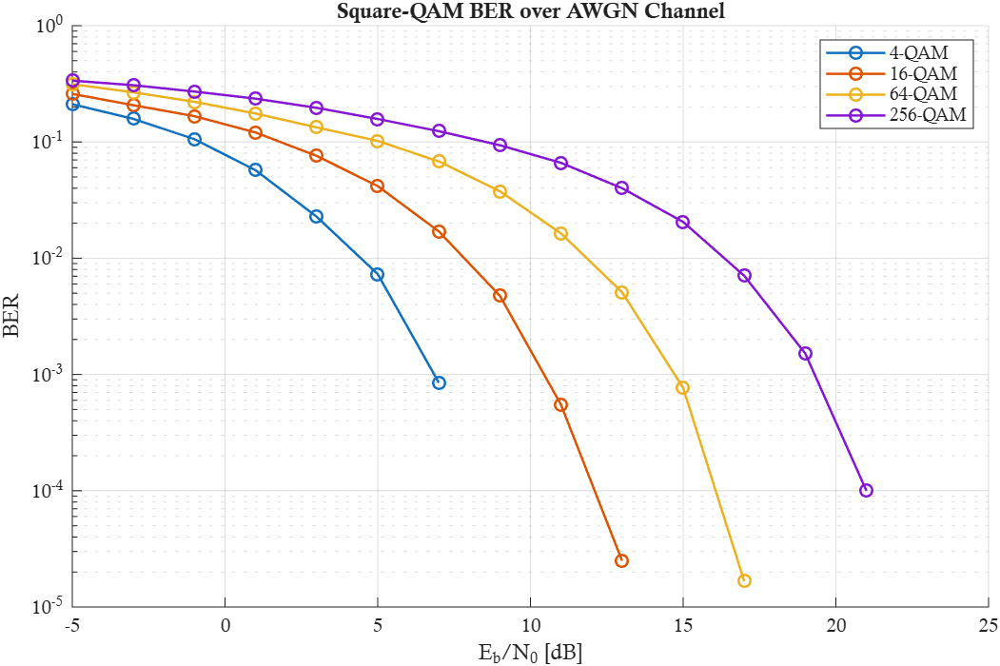
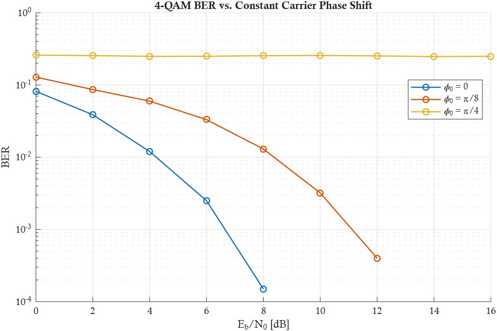
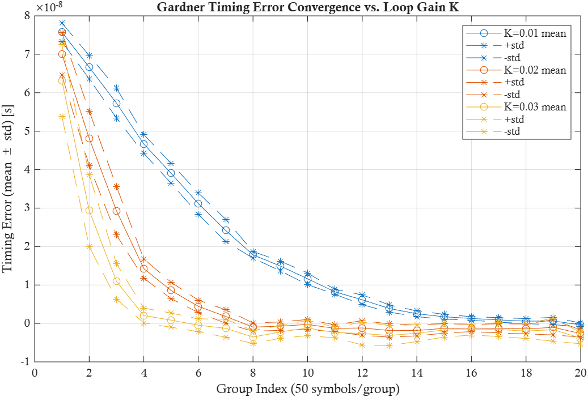
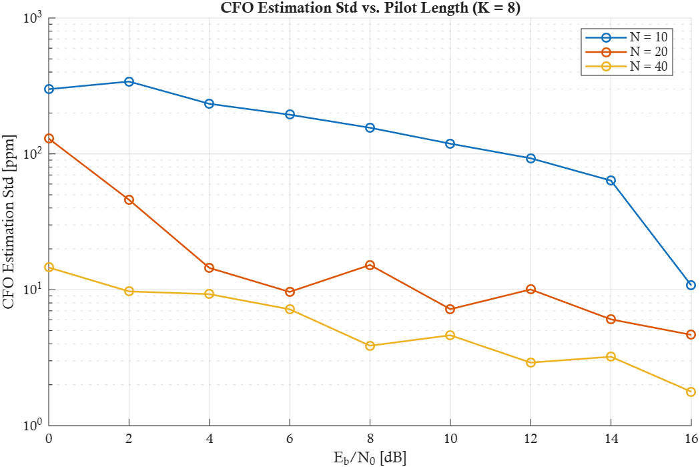
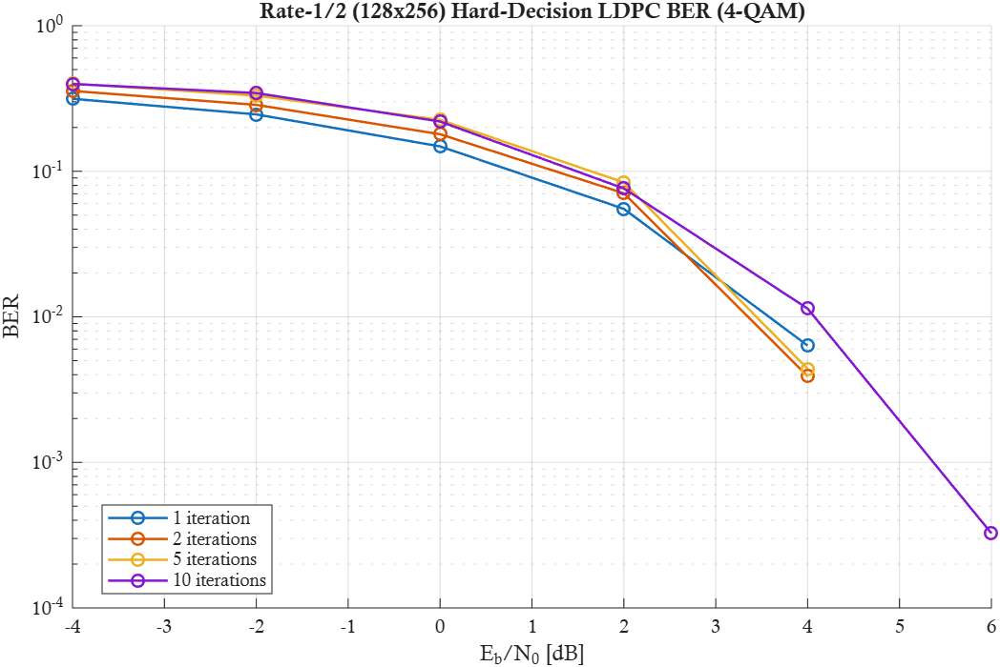

# Baseband Digital Communications: QAM, Synchronization & LDPC Simulator

Implements an end-to-end baseband physical-layer link in MATLAB covering Gray-coded Square-QAM (`4/16/64/256-QAM`), half-Nyquist root-raised-cosine pulse shaping, carrier/timing synchronization impairments and recovery loops, and rate-1/2 hard-decision LDPC coding. Demonstrates how phase, CFO, and timing errors create BER floors and how Gardner timing recovery paired with differential pilot acquisition restores near-AWGN reliability.

## System & Processing Pipeline



1. **`src/step1_qam_ber_awgn.m`** — Gray-coded `4/16/64/256-QAM` symbol mapping, normalized RRC pulse shaping/matched filtering (`rolloff = 0.2`), and AWGN BER curves (`-5..25 dB`).
2. **`src/step2_sync_impairment_constellations.m`** — Visualizes 4-QAM constellation rotation under constant carrier phase offset (`pi/8`) and progressive CFO phase drift (`10 ppm`, `600 MHz`).
3. **`src/step3_sync_impairment_ber.m`** — Sweeps 4-QAM BER (`M = 100`, `0..16 dB`) under CFO ISI (`0..50 ppm`), constant phase offset (`0, pi/8, pi/4`), and timing sampling offset (`0..0.3 T`).
4. **`src/step4_gardner_timing_recovery.m`** — Evaluates non-data-aided Gardner TED timing lock from `Shift = 0.40 T` across loop gains `K = [0.01, 0.02, 0.03]` and CFO up to `50 ppm`.
5. **`src/step5_frame_cfo_acquisition.m`** — Benchmarks pilot differential ToA and CFO estimation standard deviation across pilot lengths `N = [10, 20, 40]` and averaging lags `K = [1, 8, 16]` (`20` trials, `0..16 dB`).
6. **`src/step6_full_sync_receiver.m`** — Chains Gardner timing recovery (`Shift = 0.17 T`), pilot ToA/CFO estimation (`600 MHz`), and inter-pilot phase interpolation on `16-QAM` across `[0, 2, 10, 50] ppm`.
7. **`src/step7a_ldpc_small_matrix_demo.m` & `src/step7b_ldpc_hard_ber.m`** — Verifies `(5 x 10)` systematic Gauss-Jordan encoding (`0` mismatches) and simulates `(128 x 256)` rate-1/2 hard-decision LDPC decoding (`1..10` iterations, `-4..10 dB`).

## Key Results

Verified metrics recorded on MATLAB R2026b (`rng(0)` deterministic seeds):

| Module | Operating Condition | Verified Metric |
| :--- | :--- | :--- |
| **Step 1: Uncoded AWGN BER** | `E_b/N_0 = 15 dB` (`4 / 16 / 64 / 256-QAM`) | `BER = 0 / 0 / 7.67e-4 / 2.05e-2` |
| **Step 3: 4-QAM Phase / CFO Floor** | `E_b/N_0 = 10 dB` (`phi_0 = 0 / pi/8 / pi/4`) | `BER = 0 / 3.20e-3 / 2.57e-1` (`50 ppm` CFO: `1.385e-2`) |
| **Step 4: Gardner Convergence** | `Shift = 0.40 T`, `K = 0.01 / 0.02 / 0.03` | Final `epsilon = 0.3981 / 0.4041 / 0.4034`; final group mean error `-0.36 / -2.61 / -3.82 ns` |
| **Step 5: Pilot Acquisition** | `16 dB`, `K = 8`, `N = 10 / 20 / 40` | Mean ToA error: `0.00 / 0.00 / 0.00` samples; CFO std: `10.76 / 4.66 / 1.78 ppm` |
| **Step 6: Full 16-QAM Receiver** | `Shift = 0.17 T`, `CFO = 0 / 2 / 10 / 50 ppm` | `toa = 930`; `est_CFO = 30.11 kHz` (`@ 50 ppm`); bit errors `0 / 0 / 0 / 5,058` |
| **Step 7b: `(128 x 256)` Hard LDPC** | `10` iterations, `E_b/N_0 = -4..10 dB` | `0.3978 (-4 dB) -> 0.2197 (0 dB) -> 1.139e-2 (4 dB) -> 3.255e-4 (6 dB) -> 0 (8-10 dB)` |


*Figure 1 (`step1_qam_fig03.png`): Simulated AWGN BER waterfalls for Gray-coded 4-, 16-, 64-, and 256-QAM.*


*Figure 2 (`step3_imp_fig03.png`): Uncompensated constant carrier phase rotation creating an irreducible `0.25` BER floor at `phi_0 = pi/4`.*


*Figure 3 (`step4_gardner_fig03.png`): Closed-loop Gardner timing error (`mean ± std`) from `0.40 T` across loop gains `K = 0.01, 0.02, 0.03`.*


*Figure 4 (`step5_acq_fig03.png`): Differential cross-correlation CFO estimation standard deviation vs. `E_b/N_0` across pilot lengths `N = 10, 20, 40`.*


*Figure 5 (`step7b_ldpc_fig01.png`): Rate-1/2 `(128 x 256)` regular LDPC hard-decision BER across `1, 2, 5, 10` Tanner-graph iterations.*

## Repository Layout & Quickstart

```text
digital-comms-qam-sync-ldpc/
├── src/
│   ├── step1_qam_ber_awgn.m                     # Gray-coded QAM AWGN BER simulation
│   ├── step2_sync_impairment_constellations.m   # Constellation phase & CFO drift plots
│   ├── step3_sync_impairment_ber.m              # CFO, phase shift, and timing-offset BER sweeps
│   ├── step4_gardner_timing_recovery.m          # Closed-loop Gardner timing error detector
│   ├── step5_frame_cfo_acquisition.m            # Pilot ToA & CFO std sweep (N, K, Eb/N0)
│   ├── step6_full_sync_receiver.m               # Integrated Gardner + ToA/CFO + phase unwrap receiver
│   ├── step7a_ldpc_small_matrix_demo.m          # Systematic (5x10) parity-check self-test
│   ├── step7b_ldpc_hard_ber.m                   # Rate-1/2 (128x256) hard-decision LDPC BER sweep
│   └── lib/                                     # 11 shared PHY & LDPC helper functions
├── docs/figures/                                # Exported white-background figures (22 PNGs)
├── .gitignore
├── LICENSE
├── THIRD_PARTY_NOTICES.md                       # Attribution for Bagawan Nugroho LDPC routines
└── README.md
```

`src/lib/` contains: `add_awgn.m`, `compute_eb.m`, `demapping.m`, `encode_ldpc.m`, `frame_cfo_acquisition.m`, `gardner_ted.m`, `generate_ldpc.m`, `half_nyquist_filter.m`, `ldpc_hard_decode.m`, `mapping.m`, `plot_ber_curves.m`.

- **MATLAB & Toolboxes:** MATLAB R2020b+ (verified on R2026b) with **Communications Toolbox** (`bi2de`) and **Signal Processing Toolbox** (`upsample`, `downsample`).
- **Entry-Point Run Order:**
  ```matlab
  run('src/step1_qam_ber_awgn.m')
  run('src/step2_sync_impairment_constellations.m')
  run('src/step3_sync_impairment_ber.m')
  run('src/step4_gardner_timing_recovery.m')
  run('src/step5_frame_cfo_acquisition.m')   % Slow Monte Carlo sweep (~108 s)
  run('src/step6_full_sync_receiver.m')
  run('src/step7a_ldpc_small_matrix_demo.m')
  run('src/step7b_ldpc_hard_ber.m')
  ```
- **Runtime & Scope Notes:** `step7a` runs in `<0.1 s`; `step1` (`~12 s`), `step2` (`~8 s`), `step3` (`~27 s`), `step4` (`~10 s`), `step6` (`~6 s`), `step7b` (`~15 s`). Soft-decision (LLR / belief propagation) LDPC decoding is omitted as only hard-decision decoders were present in the original source archive.
  > [!WARNING]
  > `src/step5_frame_cfo_acquisition.m` runs a 20-trial Monte Carlo sweep across 9 SNR points and `(N, K)` configurations at `M = 100` oversampling (~`108 s` observed).

## Dependencies & License

- **Third-Party Helpers:** `src/lib/generate_ldpc.m` and `src/lib/encode_ldpc.m` were authored by **Bagawan Nugroho** and retain their original attribution; see [THIRD_PARTY_NOTICES.md](THIRD_PARTY_NOTICES.md).
- **License:** Original simulation scripts and custom helpers are licensed under the [MIT License](LICENSE) (`Copyright (c) 2026 Mathis Melki`).
